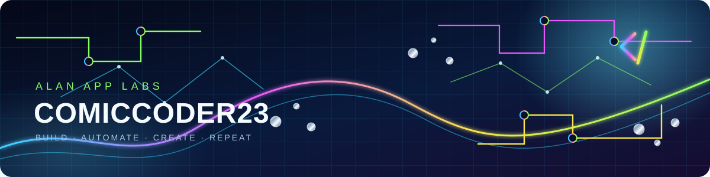
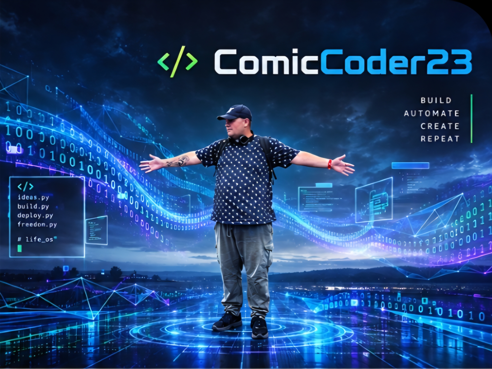

<!-- Author: Codex (GPT-5, local) · Lane: local · Date: 2026-10-18 -->

  

  

<h1 align="center">⌁ ComicCoder23</h1>

<strong>Alan App Labs · build / automate / create / repeat</strong>

I'm Alan, in Kirkintilloch. Customer service since 2004, HNC Computing, now moving into first-line IT support — building practical local-first tools in public as <strong>ComicCoder23</strong>.

## Signal deck — the kit I use hands-on

<strong>Build</strong>

  
  
  
  
  
  
  
  
  

<strong>Ship, data &amp; automation</strong>

  
  
  
  
  
  
  
  

<strong>Operator stack</strong>

  
  
  
  
  
  
  
  

Hover an icon for its quick description; tap/click opens the official tool. The key below stays readable on mobile and with assistive technology.

| Signal | Hands-on role |
|---|---|
| Build | JavaScript, TypeScript, HTML, CSS, React, Node.js, Vite, Tailwind CSS and WebAssembly |
| Ship, data &amp; automation | Git, GitHub, GitHub Actions, Docker, PostgreSQL, Supabase, VS Code and PowerShell |
| Operator stack | Obsidian, Notion, Airtable, Linux, Linux Mint, Tailscale, Windows / Remote Desktop Connection and Figma |

## The operating idea

**Local-first. Free-first. Own the connections.** No middleware rent, no data shipped to someone else's cloud. Everything runs on a 2012-era machine with 12GB of RAM — if it works here, it works anywhere.

## Latest build — Look Up

**[Use it → comiccoder23.github.io/lookup](https://comiccoder23.github.io/lookup/)** · [source](https://github.com/ComicCoder23/lookup)

An eclipse companion for 12 August 2026, built and shipped from a phone the day before the eclipse. Type your town and it computes your times to the second from your own coordinates — Meeus solar theory, verified against sixteen published city timings to within seven seconds — then talks you through the whole event with your phone in your pocket. Forecast says clouds? It checks the sky in every direction around you and points you at the nearest gap, by car or bus. One HTML file on GitHub Pages. No tracking, no signup, no app store — open it once and "Add to Home screen" installs it like an app. Honest exit codes, but for the sky.

## Now building

| Project | What it is |
|---|---|
| [memory-city](https://github.com/ComicCoder23/memory-city) | Ops tooling for local AI-agent memory — provably read-only archive search, healthchecks that can actually fail, smoke tests that clean up after themselves |
| Agent control tower | One pane of glass for a multi-agent studio: lanes, work queue, port registry, live vitals — JSON truth, regenerated views |
| A comedy app | In build. A mysterious stage manager may or may not be involved. 🎭 |

## House rules (the code kind)

1. **Honest exit codes.** A tool that can't do its job says so loudly. Most of my tooling exists because of tools that lied politely.
2. **If it isn't registered, it doesn't exist.** State lives in files you can read, not in anyone's head.
3. **The demo machine is the real machine.** No cloud-shaped excuses.
4. **One day at a time ships more than one big push.** True in recovery, true in git.

## Elsewhere

- 🐦 [@ComicCoder23](https://x.com/ComicCoder23) — build log & operator notes
- ☕ [ko-fi.com/comiccoder23](https://ko-fi.com/comiccoder23) — the tip jar, entirely optional
- ⭐ Best way to support the work: star it, fork it, break it, tell me what broke

*Built with a crew of AI agents and one stubborn human. The human writes the jokes.*
